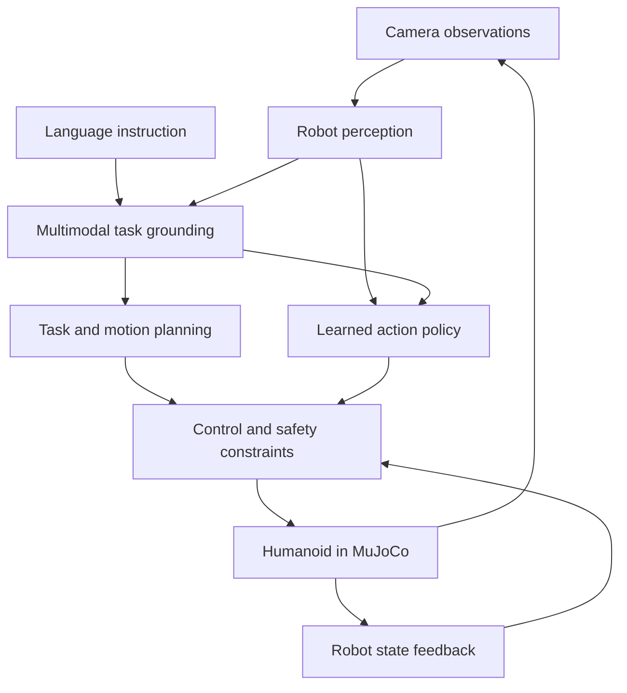

# Hi, I'm Ben 👋

### Aspiring Humanoid Robotics Engineer

**Robot Perception · Embodied AI · Vision-Language-Action**

Computer Engineering Student at HCMUT, Vietnam

*Building the foundations for robots that perceive, understand, and act.*

  <a href="https://github.com/benhiepcse/Deep-Learning-Image-Classification-Explainability">Current Project</a> ·
  <a href="https://www.linkedin.com/in/levonghiahiep">LinkedIn</a> ·
  <a href="mailto:work.levonghiahiep@gmail.com">Email</a>

---

## About Me

I'm **Lê Võ Nghĩa Hiệp (Ben)**, a Computer Engineering student at **Ho Chi Minh City University of Technology (HCMUT)**, working towards a career in **Humanoid Robotics and Embodied AI**.

My intended specialization is **robot perception and vision-language-action (VLA)**: connecting visual observations and language instructions to robot behavior. I'm currently building my machine learning and deep learning foundations through practical projects, with an emphasis on understanding, reproducibility, and evaluation.

Long term, I want to integrate perception and learned policies with motion planning and control for **language-guided manipulation and humanoid loco-manipulation**.

## Engineering Direction

| Area | What I aim to build |
|---|---|
| **Robot Perception** | Visual representations, object detection, tracking, and scene understanding |
| **Multimodal Intelligence** | Grounding language instructions in visual observations with VLMs |
| **Robot Learning** | Learning action policies through imitation learning and reinforcement learning |
| **Humanoid Integration** | Connecting perception and policies with planning, control, and simulation |

These are my learning and project directions; completed work will be linked as it becomes available.

## Target System Architecture

*Conceptual architecture for future projects; this is not a completed system.*

My intended focus is **perception, multimodal grounding, and learned policies**. Planning, control, and simulation are integration interfaces developed with my teammate. This diagram shows possible module relationships; specific projects may use different architectures.

## Current Project

### [H01 — Deep Learning Image Classification & Explainability](https://github.com/benhiepcse/Deep-Learning-Image-Classification-Explainability)

**In progress · Individual project**

Building a reproducible image classification workflow while learning how to implement, inspect, and debug deep learning systems.

- **Planned scope:** CIFAR-10 data preparation, a CNN baseline, training and evaluation, and explainability.
- **Engineering focus:** data integrity, tensor and gradient checks, reproducible experiments, and documented evidence.
- **Connection to robotics:** developing visual learning and evaluation foundations for later robot perception projects.

Implementation details and available evidence are maintained in the project repository.

## Project Roadmap

| Project | Focus | Status |
|---|---|---|
| **H01 · Image Classification & Explainability** | Deep learning foundations and visual model analysis | In progress |
| **H02 · Real-Time Object Detection & MOT** | Object detection and multi-object tracking | Planned |
| **H04 · DRL for Vision-Based Robotic Manipulation** | Learning manipulation policies from visual observations | Planned |
| **C03 · Language-Guided Robotic Manipulation** | Connecting language, perception, and manipulation in a shared project | Planned |
| **Graduation Project · Voice-Guided Humanoid Intelligence & Whole-Body Loco-Manipulation** | Integrating language-guided tasks with humanoid behavior in MuJoCo | Long-term target |

For shared robotics projects, my intended focus is **perception, multimodal understanding, and learned action policies**, working with a teammate specializing in **control and simulation**. We aim to understand and integrate the complete system together.

## Learning Path

| Stage | Topics | Purpose |
|---|---|---|
| **Foundations** | Python, C++, Linux, Git, linear algebra, probability, optimization | Write reliable code and understand learning algorithms |
| **Visual Learning** | PyTorch, CNNs, training, evaluation, explainability | Build and diagnose visual models |
| **Robot Perception** | OpenCV, detection, tracking, camera geometry, depth, coordinate transforms | Relate images to objects and robot coordinates |
| **Multimodal Models** | Transformers, language modeling foundations, VLMs, visual grounding | Connect language with visual context |
| **Action Learning** | Imitation learning, reinforcement learning, VLA models | Learn observation-conditioned robot policies |
| **System Integration** | ROS 2, MuJoCo, planning and control interfaces | Evaluate perception-to-action systems in simulation |

*This is a learning roadmap, not a list of mastered skills. Topics may overlap as projects require them.*

## Tools & Technologies

**Current project tools**

  

**Developing towards:** C++ · OpenCV · ROS 2 · MuJoCo · robot learning workflows

## Engineering Principles

- **Understand before scaling:** trace data, model outputs, loss, gradients, and parameter updates.
- **Evaluate with evidence:** use clear baselines, metrics, and failure analysis.
- **Make experiments reproducible:** record configurations, seeds, environments, and results.
- **Build towards integration:** define interfaces between perception, policies, planning, and control.

## GitHub Stats

  
  

*Language statistics describe repository code composition, not proficiency.*

## GitHub Activity Graph

  

More GitHub activity · Streak & Trophies

  

  

## Connect

  
  
  

---

**Perceive the world. Understand the task. Learn to act.**

